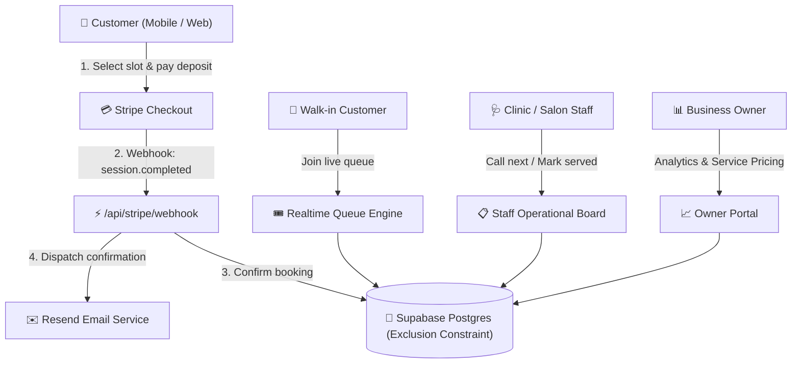

# QueueLine 🚀

> **Live Queue & Smart Booking Platform for Small Clinics and Salons**

QueueLine eliminates no-shows and waiting room chaos. Customers book guaranteed time slots with Stripe deposit payments, or join a live walk-in queue from their mobile device to track their queue position in realtime. Staff run daily schedules from any tablet, and clinic owners monitor bookings, revenue, and queue wait metrics.

---

## 🎯 Architecture & System Overview



---

## ✨ Key Features

- **Double-Booking Elimination & Calendar Architecture:** Enforced via PostgreSQL GiST exclusion constraint on `(business_id, tstzrange(starts_at, ends_at))` for active bookings using the `btree_gist` extension. Overlapping reservations are rejected at the database engine level (HTTP 409 `SLOT_CONFLICT`).
  > **Design Note on Scheduling Architecture:** QueueLine utilizes a business-level calendar constraint (optimized for solo aesthetic practitioners, boutique clinics, and appointment studios). For multi-provider practices with independent practitioner schedules, the exclusion constraint can be expanded to composite `(business_id, staff_id, tstzrange(starts_at, ends_at))` indexing.
- **Deposit-Secured Bookings & Multi-Payment Strategy:**
  - **Pay at Venue (Primary for Pakistan & Cash-Preferred Markets):** Allows customers to lock in their slot immediately without requiring an upfront credit card. The PostgreSQL exclusion constraint immediately protects the slot against duplicate reservations.
  - **Online Card Deposit (Stripe Test Mode):** Full Stripe Checkout session creation and idempotent webhook handler are fully integrated for international businesses and demonstration.
  - **Local Card Gateway Extensibility:** Designed for modular expansion to local gateways (such as Safepay or PayFast) for Pakistani card payments.
- **Idempotent Webhooks:** All incoming Stripe events are logged in the `stripe_events` table by ID to prevent duplicate confirmations or repeat email deliveries.
- **Live Walk-in Queue:** Customers grab a digital ticket (`#A014`), see their position, people ahead, and receive haptic/audio alerts when called.
- **Staff Operational Hub:** Receptionists and service providers call the next ticket, mark customers as served, or flag no-shows with single-click actions.
- **Owner Business Analytics:** Real-time visibility into daily revenue, booking counts, no-show percentages, and service pricing configuration.

---

## 🛠️ Tech Stack

- **Framework:** Next.js 15 (App Router), TypeScript, Tailwind CSS, Lucide Icons, Framer Motion
- **Database & Auth:** Supabase (Postgres, Row Level Security, Realtime subscriptions)
- **Payments:** Stripe Checkout & Webhook API
- **Transactional Email:** Resend
- **Validation:** Zod schemas
- **Containerization:** Multi-stage Dockerfile + `docker-compose.yml`

---

## 🚀 Quick Start (Local Development)

### 1. Clone & Install
```bash
git clone https://github.com/CtrlAltHamza/queueline.git
cd queueline
npm install
```

### 2. Configure Environment
```bash
cp .env.example .env.local
```

### 3. Run Development Server
```bash
npm run dev
```
Visit [http://localhost:3000](http://localhost:3000) to view the application.

---

## 🧪 Testing & Database Reset

- **Postgres Migrations:** Located in `supabase/migrations/00001_initial_schema.sql`
- **Seed Data:** Located in `supabase/seed.sql`
- **pgTAP RLS Test Suite:** Located in `supabase/tests/rls_test.sql`

Run database verification:
```bash
supabase db reset
supabase test db
```

---

## 🐳 Docker Deployment

Run the complete stack with Stripe webhook listening:
```bash
docker compose up -d
```
