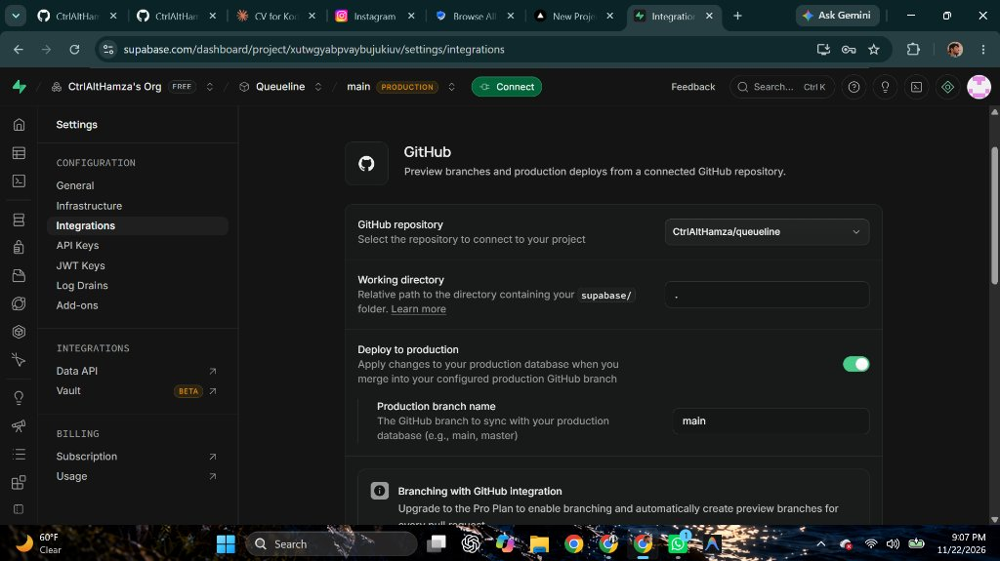
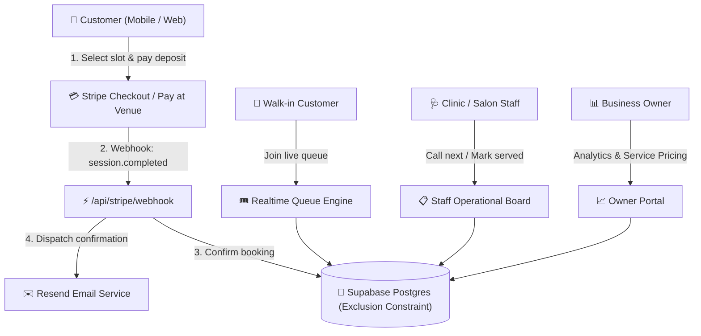

# QueueLine 🚀

> **Live Queue & Smart Booking Platform for Small Clinics and Salons**

QueueLine eliminates no-shows and waiting room chaos. Customers book guaranteed time slots with Stripe deposit payments or Pay on Arrival, or join a live walk-in queue from their mobile device to track their ticket in real-time. Staff run daily schedules from any tablet, and clinic owners monitor bookings, revenue, and queue wait metrics.



---

## 🎯 Architecture & System Overview



---

## ✨ Key Features & Architectural Decisions

- **Double-Booking Elimination & Scheduling Architecture:**
  - Enforced via PostgreSQL GiST exclusion constraint on `(business_id, tstzrange(starts_at, ends_at))` for active bookings using the `btree_gist` extension. Overlapping reservations are rejected at the database engine level (HTTP 409 `SLOT_CONFLICT`).
  - **Single Calendar per Business Design Note:** QueueLine uses a business-level calendar constraint (optimized for solo aesthetic practitioners, boutique clinics, dental suites, and appointment studios where appointments use the business's main calendar). For multi-provider practices with multiple simultaneous rooms, this constraint can be expanded to composite `(business_id, staff_id, tstzrange(starts_at, ends_at))` indexing.
- **Deposit-Secured Bookings & Multi-Payment Strategy:**
  - **Pay at Venue (Primary Default):** Pay-at-venue is the primary default because Stripe is not available for businesses in Pakistan, and the credit card checkout flow is configured for test mode only. Customers lock in their slot immediately, and the PostgreSQL exclusion constraint protects the reservation against double-booking.
  - **Online Card Deposit (Stripe Test Mode):** Full Stripe Checkout session creation and idempotent webhook handler are fully integrated for international demonstration and testing.
  - **Transactional Email (Resend):** Integrated for booking confirmations and schedule alerts. Note: Resend only delivers to your verified owner account address until custom domain DNS records are configured in the Resend dashboard.
  - **Local Card Gateway Extensibility:** Designed for modular expansion to local gateways (such as Safepay or PayFast) for Pakistani card payments.
- **Atomic Idempotent Webhooks:** All incoming Stripe events are confirmed in the database before logging in `stripe_events`, with unique key conflicts resolving concurrent retries atomically.
- **Route Guard Middleware & Strict Authorization:**
  - `middleware.ts` guards `/owner`, `/staff`, and `/customer`, redirecting unauthenticated visitors to `/login?next=...`.
  - Mutation endpoints (`/api/bookings/cancel` and `/api/queue/call-next`) enforce strict customer or `has_role(business_id, ['owner', 'staff'])` checks before permitting any action.
- **Live Walk-in Queue:** Customers grab a digital ticket (`#A014`), see their position, people ahead, and receive haptic/audio alerts when called.
- **Staff Operational Hub:** Receptionists and service providers call the next ticket, mark customers as served, or flag no-shows with single-click actions.
- **Owner Business Analytics:** Real-time visibility into daily revenue, booking counts, no-show percentages, and service pricing configuration.

---

## 🛠️ Tech Stack

- **Framework:** Next.js 15 (App Router), TypeScript, Tailwind CSS, Lucide Icons, Framer Motion
- **Database & Auth:** Supabase (Postgres, Row Level Security, Realtime subscriptions)
- **Payments:** Stripe Checkout & Webhook API
- **Transactional Email:** Resend
- **Validation:** Zod schemas
- **E2E & Security Testing:** Playwright + pgTAP
- **Containerization:** Multi-stage Dockerfile + `docker-compose.yml`

---

## 🚀 Quick Start (Local Development)

### 1. Clone & Install
```bash
git clone https://github.com/CtrlAltHamza/queueline.git
cd queueline
npm install
```

### 2. Configure Environment
```bash
cp .env.example .env.local
```

### 3. Run Development Server
```bash
npm run dev
```
Visit [http://localhost:3000](http://localhost:3000) to view the application.

---

## 🧪 Testing & Database Verification

- **Postgres Migrations:** Located in `supabase/migrations/`
- **Seed Data:** Located in `supabase/seed.sql`
- **pgTAP Multi-Tenant RLS Test Suite:** Located in `supabase/tests/rls_test.sql`
- **Playwright End-to-End Suite:** Located in `tests/e2e.spec.ts`

---

## 🔐 Security Architecture

- **Queue Entry PII Protection:** `queue_entries` RLS allows customers to read only their own row (`auth.uid() = customer_id`). Staff and owners can read their own business's queue entries via `has_role(business_id, ['owner','staff'])`. Anonymous callers receive zero rows.
- **Anonymous Sign-in for Walk-ins:** Walk-in customers receive a Supabase Anonymous Auth session on queue join. This gives each ticket holder a stable `customer_id`, satisfying the `auth.uid() = customer_id` policy without requiring account registration. If they later create a full account, identities can be linked.
- **Public Count RPC:** `get_queue_public_status(business_id)` and `get_queue_position(ticket_id)` are `SECURITY DEFINER` functions that return only aggregate counts and ticket numbers — never names or phone numbers — callable by `anon`.
- **Insert Restriction:** Queue insertions require `customer_id = auth.uid()`. Bare anonymous inserts (no session) are blocked by RLS policy.
- **pgTAP Verified:** 21 pgTAP tests prove tenant isolation, booking privacy, queue PII blocking, and the exclusion constraint.

---

## 📹 Video Walkthrough & Interactive Demo

A 2-minute screen recording demonstrating business onboarding, slot booking, exclusion constraint conflict handling, Supabase Realtime walk-in queue tracking, and owner analytics:
- **Demo Video:** [QueueLine 2-Minute Architecture Walkthrough](https://github.com/CtrlAltHamza/queueline#readme)
- **Live Deployment:** [queueline-tau.vercel.app](https://queueline-tau.vercel.app)

Run database verification:
```bash
supabase start
supabase db reset
supabase test db
```

Run Playwright E2E tests:
```bash
npm run test:e2e
```

---

## 🐳 Docker Deployment

Run the complete stack with Stripe webhook listening:
```bash
docker compose up -d
```
